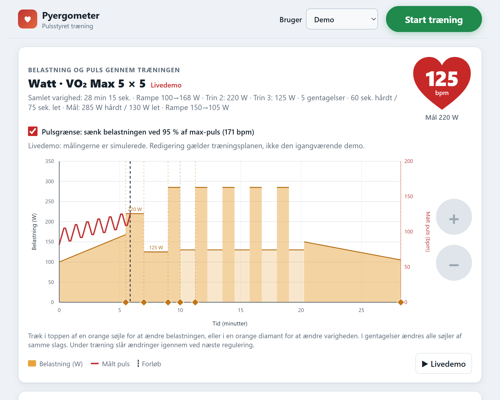
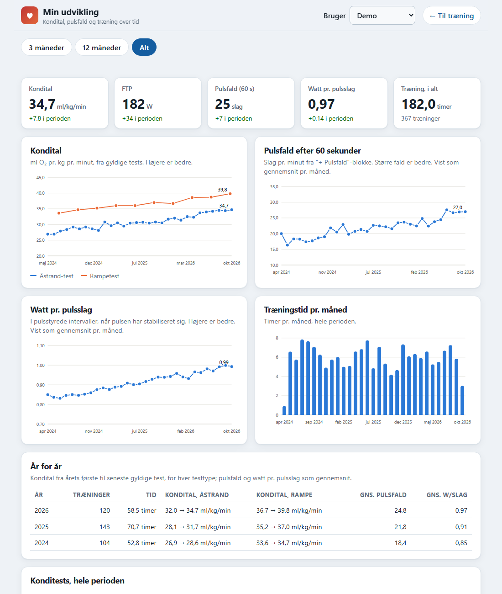

pyergometer
===========

This program connects to a Kettler ergometer (tested with model E3)
through a serial connection and, following a user-specified program, controls the
ergometer power setting to keep the subject's heart rate at a desired level (which
may or may not vary during the program run).

The program can also run in "fixed" mode, i.e. setting power levels at
set times given in the user program.

Pulse, power and pedaling rpm are optionally recorded to a log file
that can be used to e.g. visualize the run afterwards.

This fork
---------

This is a fork of [kahara/pyergometer](https://github.com/kahara/pyergometer)
by Joni Kähärä. It keeps the original pulse control and adds a web page for
building and running workouts from a PC, phone or tablet, user profiles with
maximum pulse, smartwatch heart rate over Bluetooth LE, a live pulse chart,
and a driver template for adding other ergometers. The aim is to run it on a
Raspberry Pi next to the bike. The upload of sessions to the original author's
S3 bucket has been removed; all data stays on the local computer.

Quick start on Windows: double-click ``start.bat``. It starts the page on
``http://127.0.0.1:8765/`` and prints the address to use from other devices
on the same network.

Raspberry Pi
------------

Install Raspberry Pi OS Lite (64-bit) with Raspberry Pi Imager, with SSH,
Wi-Fi and a hostname such as ``ergometer`` set in its settings. Log in with
``ssh <user>@ergometer.local`` and run:

    sudo apt update && sudo apt install -y git
    git clone https://github.com/amtssp/pyergometer.git
    cd pyergometer && ./install-pi.sh

``install-pi.sh`` installs the Python packages in ``.venv``, gives the user
access to the serial port and Bluetooth, sets a Kettler on ``/dev/ttyUSB0`` as
the default bike, and installs the ``pyergometer`` service so the page starts
whenever the Pi boots. Open ``http://ergometer.local:8765/`` from a phone,
tablet or PC on the same network. Later, ``./update.sh`` fetches the newest
version from GitHub and restarts the service; it refuses while a workout is
running. Profiles, saved workouts, bike settings and logs are kept.

Useful commands on the Pi: ``sudo systemctl status pyergometer`` and
``journalctl -u pyergometer -f`` to follow the log.

``install-pi.sh`` also installs ``pyergometer-wifi-watchdog``, which checks the
Wi-Fi every minute. After 3 minutes without a connection it asks
NetworkManager to reconnect; after 5 minutes it reloads the Wi-Fi driver and,
for a USB dongle, unplugs and replugs it in software, repeating every 10
minutes. It works with any adapter and does nothing on a cable-only setup.
Rebooting as a last resort is off; set ``REBOOT_AFTER`` (seconds) in the
service to enable it. Follow it with ``journalctl -u pyergometer-wifi-watchdog -f``.

Starting the program without a session file opens a local workout builder:

    ./pyergometer.py

Add ``--host 0.0.0.0`` to reach the page from phones and tablets on the local
network. Anyone on that network can then control the ergometer, so only use it
on a trusted network.

Install the Python 3 dependencies before starting the workout builder:

    python -m pip install -r requirements.txt

Choose a maximum pulse, add work intervals as a percentage of that maximum,
and add low-load breaks with a duration and watt setting. The page calculates
the target pulse for each interval and starts the existing control program.
Maximum pulse belongs to the user profile: choose it in 10-bpm increments or
calculate it from birth year with `208 - (0.7 * age)`; the estimate is rounded
to the nearest bpm. It is saved automatically when changed and cannot be
overridden for a single workout.
Create one user profile for each person using the ergometer. Maximum pulse,
workout setups and the selected smartwatch are stored separately for each
profile, so selecting a profile switches to that person's settings. Existing setups in
``workouts.json`` are kept under the initial ``Standard`` profile. New profile
data is stored locally in the Git-ignored ``user_profiles.json`` file.
The chosen profile is remembered per browser, so a new phone or tablet starts on
``Standard``. Pressing Start there first asks whether to train as one of the
other profiles, create a new one or continue as ``Standard``.
Name and save workout setups locally, then load them again from that profile's
saved setup list. Presets contain only the ordered intervals and breaks, with
pulse targets as a percentage of maximum, so the same workout adapts to each
person's maximum pulse.
During a workout or livedemo, a heart above the chart shows the current pulse
in large digits together with the current target.
Switching user profiles clears the previous workout's chart and resets the
unsaved form so that one person's workout history is not shown for another.
The shared workout template list includes a 20-minute HIIT session: 4 minutes
at 80 W, 13 repetitions of 30 seconds at 150 W plus 30 seconds at 50 W, then
3 minutes at the ergometer's minimum 25 W. It sets the watts because the pulse
cannot follow 30-second intervals. ``Puls · Intervaller 3 × 3 min`` is the
pulse-controlled alternative: 5 minutes at 60% of maximum pulse, 3 repetitions
of 3 minutes at 85% plus 3 minutes at 65%, then 3 minutes at 25 W. The shared
template named ``Watt · HIIT 30/30 (13 gentagelser)`` is
copied into the editable plan and cannot be overwritten. The watt-controlled
template ``Watt · VO₂ Max 5 × 5`` is a 28¼-minute session: a 100 → 168 W ramp,
220 W and 125 W openers, 5 repetitions of 1 minute at 285 W plus 1¼ minutes at
130 W, and a 150 → 105 W cool-down ramp. Template names start with ``Puls`` or
``Watt`` to show how they are controlled. Save a customized
version under a new name on the selected profile. Repeat groups can be adjusted
by changing their repetition count, work/recovery durations in seconds, and
work/recovery pulse targets. The controller receives each repeated phase at
its exact second boundary.
The pulse chart shows target intervals, measured pulse, and elapsed workout
time. If no maximum pulse has been selected yet, the plan is still shown using
pulse targets as percentages of maximum until a maximum pulse is chosen. While
setting up a workout, drag a blue target line vertically to change
an interval's target pulse, or drag the orange diamond at a block's end
horizontally to change its duration. The corresponding plan fields update and
are used when saving or starting the workout; during a livedemo, edits apply
to the next workout. During a real workout, the same chart controls send
changes to the ergometer immediately; the new target is used at the next
one-second control update, and a shortened workout ends at its updated finish
time. The start button changes to a red ``Stop træning`` button while active;
stopping sends a controlled command and reduces the ergometer load to 25 W.
Measurements are sampled and displayed about once per second. Use
``Afspil livedemo med simuleret puls`` to preview the chart without starting
the ergometer; demo measurements are synthetic and are not saved as workout
results.
As an alternative to the ergometer's pulse sensor, select ``Smartwatch via Bluetooth
LE`` and scan for the watch once while setting up its user profile. The selected
watch is remembered for that profile, and the app tries that saved device at
the next workout without scanning again. If the watch cannot be found or its
Bluetooth address has changed, scan and select it again. The watch must broadcast the standard Bluetooth
Heart Rate Service (UUID 180D); the workout page reads its heart-rate
notifications directly, without a phone relay. Enable the watch's heart-rate
broadcast mode before connecting. If another app is already connected to the
watch, close it if the workout page cannot connect. Pulse samples stay on the
local computer and are not uploaded. If the watch connection is lost, the page
reports the error and the ergometer holds its current load until fresh watch
readings resume.
The builder is available only on the local computer. Session logs are written
to ``data/`` with Windows-compatible timestamped filenames.

A workout is either pulse-controlled or watt-controlled; choose under the
workout plan. In a pulse-controlled workout the load is regulated to hold the
pulse at each target (a percentage of maximum pulse). In a watt-controlled
workout the load follows the plan in watts, starts as soon as the pedals turn
and needs no maximum pulse; if a maximum pulse is known, the load is lowered
automatically while the pulse is at or above 95 % of it. Both kinds support
steady steps, ramps that change linearly over their duration, and repeat
groups. The heart above the chart always shows the measured pulse.

Fitness tests
-------------

Two shared templates measure fitness; fill in birth year, sex and weight on
the user profile first. Results are saved in the Git-ignored
``training_history.json`` together with a summary of every workout (pulse,
watt, energy, watt per heartbeat in settled pulse intervals and every
"+ Pulsfald" pulse-drop block, where the rider sits still for 60 seconds).
The drop is measured from the pulse the workout reached, so "+ Pulsfald" goes
right after the last load: an easy ending after it (pauses, blocks named
cool-down, a falling ramp) is removed, with an undo, and a repeat right before
it leaves out its last easy interval.

* ``Test · Åstrand (submaksimal)``: 3 minutes warm-up, 6 minutes at a fixed
  load (suggested 75 W for women and 100 W for men) and a pulse drop. VO2max is
  estimated from the mean pulse in minutes 5 and 6 with the Åstrand-Ryhming
  nomogram equations (Buono et al. 1989; load in kpm/min = W x 6.12) and
  Åstrand's age correction factors (1.10 at 15 to 0.65 at 65, interpolated;
  above 65 the trend is continued, which is uncertain). The test is only
  valid with a steady pulse (at most 5 beats between minutes 5 and 6) between
  120 and 170. Typical error is about 10-15 % against a laboratory test.
* ``Test · Maksimal rampe``: 5 minutes at 50 W, then 20 W more per minute until
  the rider stops. Reports the best whole minute (MAP), FTP as 75 % of it, the
  highest pulse and VO2max estimated as 10.8 x W/kg + 7. The pulse limit is
  switched off; only ride it if you are used to maximal efforts.

Following progress
------------------

The "Min udvikling" link at the top of the workout page (or ``/udvikling``)
opens an overview of the chosen user's history. Pick the last 3 months, the
last 12 months or everything; the page shows:

* Stat tiles with the latest VO2max, FTP, 60-second pulse drop and watt per
  heartbeat, each with its change over the period, plus total training time
  and number of workouts.
* Charts of VO2max (one line per test type, since the Åstrand and ramp tests
  are not directly comparable), pulse drop and watt per heartbeat (every value
  over 3 months, weekly or monthly averages over longer periods; tests are
  never averaged), and training time per week, month or year.
* A year-by-year table: workouts, time, first-to-latest VO2max for each test
  type, average pulse drop and average watt per heartbeat.
* Tables of every fitness test (including invalid ones and the reason) and of
  every workout, newest first. Mark rows to delete them, or to move them to
  another user profile; a moved fitness test is worked out again with that
  profile's age, sex and weight. A fitness test belongs to its workout, so
  marking one marks the other.

Pulse drop and watt per heartbeat only rise when fitness improves, so they show
progress between the fitness tests without any extra effort: add a
"+ Pulsfald" block at the end of a workout and ride pulse-controlled intervals.

Supported bikes are listed in ``devices.py``: currently a Kettler on a serial
RS-232 port and a simulation. Choose the bike type on the page under
Settings, or pass ``--device-type`` on the command line (``--simulate`` is short
for ``--device-type simulator``). The bike type and serial port chosen on the
page are saved in the Git-ignored ``bike_settings.json`` and used every time
the server starts; command-line options override them. To add another bike, write a driver class with
the ``ErgometerDevice`` interface (``status()``, ``set_power()`` and the
``pulse``, ``rpm`` and ``power`` values) and add it to ``DEVICE_TYPES``; the
pulse control, chart and logs then work unchanged.

The page is available in Danish and English. Choose the language under
Settings; the choice is remembered per browser, and a first visit follows the
browser's own language. All page texts are in ``lang/<code>.json``. To add a
language, copy ``lang/en.json`` to a file named after the language code (for
example ``lang/de.json``), translate the texts and set ``language.name``; it
then appears in the language picker. A test checks that every language has
the same texts and placeholders as Danish.

To use an existing XML session directly, pass it as before:

    ./pyergometer.py --session session.xml --device /dev/ttyUSB0

Motivation
----------

I could not get [jErgometer](https://github.com/xylo/JErgometer) to work in
Mac OS X 10.6. That is, the program basically worked ok but the Java serial comms
(RXTXserial) tended to be too unstable.

License
-------

GNU General Public License version 3 or later, as chosen by the original
author. See ``LICENSE``.
